# Sports Betting Settlement Trigger Service

This Spring Boot application accepts sports event outcomes over HTTP, publishes them to Kafka, matches them to unsettled bets, and sends settlement commands through a RocketMQ boundary. Bets are stored in an in-memory H2 database. The default configuration uses Kafka with an in-process RocketMQ simulation, so the complete flow can be run locally without a RocketMQ broker.

## Quick start

### Prerequisites

- Java 17 or newer
- Docker with Docker Compose
- No local Gradle installation is required; the repository includes the Gradle wrapper

### 1. Start Kafka

```bash
docker compose up -d zookeeper kafka
```

### 2. Start the application

Linux or macOS:

```bash
./gradlew bootRun
```

Windows PowerShell:

```powershell
.\gradlew.bat bootRun
```

The application starts on `http://localhost:8080`. Confirm that it is ready:

```bash
curl -s http://localhost:8080/actuator/health
```

```powershell
Invoke-RestMethod http://localhost:8080/actuator/health
```

### 3. Publish an event outcome

Linux or macOS:

```bash
curl -i -X POST http://localhost:8080/api/event-outcomes \
  -H 'Content-Type: application/json' \
  -H 'Idempotency-Key: derby-result-1' \
  -H 'X-Correlation-Id: demo-correlation-1' \
  -d '{"eventId":"event-100","eventName":"Derby","eventWinnerId":"team-a"}'
```

Windows PowerShell:

```powershell
$headers = @{
    "Idempotency-Key" = "derby-result-1"
    "X-Correlation-Id" = "demo-correlation-1"
}
$body = @{
    eventId = "event-100"
    eventName = "Derby"
    eventWinnerId = "team-a"
} | ConvertTo-Json

Invoke-WebRequest `
    -Method Post `
    -Uri http://localhost:8080/api/event-outcomes `
    -Headers $headers `
    -ContentType "application/json" `
    -Body $body
```

The response is `202 Accepted`. This means Kafka acknowledged the event; settlement continues asynchronously.

### 4. Inspect the settled bets

Poll the bets endpoint until the two matching bets are settled:

```bash
curl -s http://localhost:8080/api/bets
```

```powershell
Invoke-RestMethod http://localhost:8080/api/bets
```

The database starts with these three bets:

| Bet | User | Event | Market | Selected winner | Amount | Initial state | State after the example |
|---|---|---|---|---|---:|---|---|
| `bet-1` | `user-1` | `event-100` | `market-1` | `team-a` | 10.00 | `PENDING` | `SETTLED_WON` |
| `bet-2` | `user-2` | `event-100` | `market-1` | `team-b` | 25.00 | `PENDING` | `SETTLED_LOST` |
| `bet-3` | `user-3` | `event-200` | `market-9` | `team-x` | 5.00 | `PENDING` | `PENDING` |

## Architecture and processing flow

```mermaid
flowchart LR
    API[POST /api/event-outcomes] -->|EventOutcomeV1| Kafka[Kafka: event-outcomes]
    Kafka --> Listener[Outcome consumer]
    Listener -->|one H2 transaction| Matching[Record outcome and match pending bets]
    Matching --> Outbox[(Settlement outbox)]
    Outbox --> Dispatcher[Outbox dispatcher]
    Dispatcher --> Mock[In-process mock queue]
    Dispatcher --> Real[RocketMQ: bet-settlements]
    Mock --> MockConsumer[Mock consumer]
    Real --> RealConsumer[Real consumer]
    MockConsumer --> Settlement[Settlement service]
    RealConsumer --> Settlement
    Settlement -->|pessimistic lock| Bets[(H2 bet state)]
```



1. The API validates the three outcome fields and waits for Kafka to acknowledge publication to `event-outcomes`.
2. The Kafka consumer records the accepted outcome, finds pending bets by Event ID, and writes one settlement command per match to the outbox in the same database transaction.
3. The outbox dispatcher claims committed commands and publishes them through either the default in-process adapter or real RocketMQ topic `bet-settlements`.
4. The corresponding consumer passes each command to the same settlement service, which locks the bet and records the final won or lost state.

The transport adapters contain no settlement rules. Detailed rationale and trade-offs are in [Architecture decisions](docs/architecture-decisions.md).

## Key design decisions

### Transactional outbox

The accepted outcome and its settlement commands commit together. RocketMQ publication happens later, outside that transaction, so a temporary transport failure cannot leave a committed outcome without its required settlement work. Failed or expired claims remain available for bounded retry.

### Duplicate handling

An optional HTTP idempotency key suppresses a confirmed repeat publication. Downstream processing is independently idempotent because transport redelivery is still possible: the first committed winner for an Event ID is authoritative, deterministic command identities protect concurrent duplicates, and an identical repeat does not create new settlement work. A conflicting winner is rejected without changing the accepted outcome.

### Safe final settlement

The settlement service validates the command against the stored bet and acquires a pessimistic database lock before the final state transition. A pending bet becomes `SETTLED_WON` when its selected winner equals the actual winner; otherwise it becomes `SETTLED_LOST`. Repeating the same settlement is a no-op, while a conflicting settlement cannot overwrite the final state.

### H2 and mock RocketMQ

H2 satisfies the assignment's in-memory database requirement while retaining real transactions, constraints, and locking. Mock RocketMQ is the default fallback permitted by the assignment: it serializes commands, queues them in process, and delivers them on a consumer thread with bounded retries. It logs message identifiers rather than complete settlement payloads.

## API usage

### `POST /api/event-outcomes`

Publishes an outcome to Kafka. All request fields are required:

```json
{
  "eventId": "event-100",
  "eventName": "Derby",
  "eventWinnerId": "team-a"
}
```

Optional headers:

| Header | Purpose |
|---|---|
| `Idempotency-Key` | Prevents a confirmed repeat request with the same key and payload from publishing to Kafka again. Reusing the key with a different payload returns `400 Bad Request`. |
| `X-Correlation-Id` | Carries a caller-provided correlation ID through HTTP and messaging logs. The application generates one when the header is absent or invalid. |

Relevant responses:

| Status | Meaning |
|---|---|
| `202 Accepted` | Kafka acknowledged the event; asynchronous matching and settlement may still be running. |
| `400 Bad Request` | The JSON, field validation, or idempotency-key use is invalid. |
| `503 Service Unavailable` | Kafka publication could not be confirmed or an idempotent publication is still in progress. |
| `500 Internal Server Error` | An unexpected server error occurred; internal diagnostics are not exposed in the response. |

Sending the same logical outcome without an idempotency key may produce another Kafka record, but outcome matching and settlement remain idempotent.

### `GET /api/bets`

Returns all bets with the assignment fields (`betId`, `userId`, `eventId`, `eventMarketId`, `eventWinnerId`, and `betAmount`) plus settlement status, settlement time, and the accepted outcome winner.

## Running with real RocketMQ

Real RocketMQ is optional. Stop any application instance running in mock mode, then start Kafka and the supplied RocketMQ services:

```bash
docker compose --profile real-rocketmq up -d
```

Linux or macOS:

```bash
./gradlew bootRun --args='--spring.profiles.active=real --rocketmq.name-server=localhost:9876'
```

Windows PowerShell:

```powershell
.\gradlew.bat bootRun --args="--spring.profiles.active=real --rocketmq.name-server=localhost:9876"
```

The `real` profile replaces the in-process publisher and consumer with RocketMQ adapters. The producer requires a successful synchronous broker acknowledgement, and the consumer listens on the configured physical topic, which defaults to `bet-settlements`.

The default mock exercises serialization, asynchronous delivery, retries, and the final database transition, but it is not a durable broker and does not demonstrate RocketMQ persistence, acknowledgements, rebalancing, or restart behavior. The latest release verification exercised the mock flow end to end and checked the real configuration statically; it did not perform a new live real-broker run.

## Running tests

Run the complete verification suite with the wrapper:

Linux or macOS:

```bash
./gradlew clean check --no-build-cache
```

Windows PowerShell:

```powershell
.\gradlew.bat clean check --no-build-cache
```

The `check` task runs both the unit-test and `integrationTest` source sets. Integration tests use embedded Kafka and H2 to cover the HTTP-to-settlement flow, Kafka retry and dead-letter behavior, outcome/outbox transaction rollback, publication leases, outbox recovery, pessimistic locking, and concurrent duplicate processing.

The verified baseline executed 87 unit tests and 34 integration tests successfully. Concurrency-sensitive integration tests also passed four executions.

## Assignment coverage

| Requirement | Implementation |
|---|---|
| Publish Event ID, Event Name, and Event Winner ID | `POST /api/event-outcomes` validates the fields and publishes `EventOutcomeV1`. |
| Consume `event-outcomes` | A Kafka listener consumes the topic and invokes transactional matching. |
| Match unsettled bets by Event ID | Pending H2 bets are queried by Event ID; each bet retains all fields required by the assignment. |
| Produce settlement messages to `bet-settlements` | Committed outbox commands are sent through the mock or real RocketMQ publisher. |
| Consume settlement messages and settle bets | Mock and real consumers use the same idempotent settlement service to persist won/lost states. |
| In-memory bet database | H2 stores the seeded bets and supporting consistency data for the application lifetime. |
| Executable mock fallback | Mock RocketMQ is the default profile and requires only Kafka to run the complete local flow. |

## Limitations

- H2 is in memory, so bets, accepted outcomes, publication claims, and outbox state are lost when the application stops.
- Kafka offsets and H2 commits are not one distributed transaction. Redelivery is expected and handled idempotently.
- Outbox and RocketMQ delivery are at least once; a crash after broker acceptance but before recording success can republish a command.
- The mock RocketMQ queue and its terminal failures exist only in the running JVM.
- Production deployment would require durable storage and operational controls such as authentication, monitoring, alerting, and controlled replay of terminal failures.
