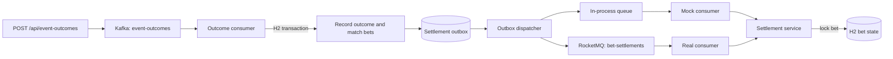

# Sports Betting Settlement Trigger Service

This service accepts a sports event result, publishes it to Kafka, matches it with open bets, and settles those bets through RocketMQ. It is built with Java 17, Spring Boot, Kafka, RocketMQ, and an in-memory H2 database.

The default setup needs only Kafka. RocketMQ is simulated in process so the whole flow works without a second broker. A real RocketMQ profile is included as an optional extra.

## Quick start

You need Java 17 or newer and Docker with Compose. Gradle is included in the repository.

Start Kafka:

```bash
docker compose up -d zookeeper kafka
```

Start the application on Linux or macOS:

```bash
./gradlew bootRun
```

On Windows PowerShell:

```powershell
.\gradlew.bat bootRun
```

Check that it is running:

```bash
curl -s http://localhost:8080/actuator/health
```

```powershell
Invoke-RestMethod http://localhost:8080/actuator/health
```

### Publish an outcome

Linux or macOS:

```bash
curl -i -X POST http://localhost:8080/api/event-outcomes \
  -H 'Content-Type: application/json' \
  -H 'Idempotency-Key: derby-result-1' \
  -H 'X-Correlation-Id: demo-correlation-1' \
  -d '{"eventId":"event-100","eventName":"Derby","eventWinnerId":"team-a"}'
```

Windows PowerShell:

```powershell
$headers = @{
    "Idempotency-Key" = "derby-result-1"
    "X-Correlation-Id" = "demo-correlation-1"
}
$body = @{
    eventId = "event-100"
    eventName = "Derby"
    eventWinnerId = "team-a"
} | ConvertTo-Json

Invoke-WebRequest `
    -Method Post `
    -Uri http://localhost:8080/api/event-outcomes `
    -Headers $headers `
    -ContentType "application/json" `
    -Body $body
```

The response is `202 Accepted`. That means Kafka accepted the message; bet settlement continues in the background.

Poll the bets endpoint:

```bash
curl -s http://localhost:8080/api/bets
```

```powershell
Invoke-RestMethod http://localhost:8080/api/bets
```

The application starts with three bets. After the example above, their states are:

| Bet | User | Event | Market | Selection | Amount | Before | After |
|---|---|---|---|---|---:|---|---|
| `bet-1` | `user-1` | `event-100` | `market-1` | `team-a` | 10.00 | `PENDING` | `SETTLED_WON` |
| `bet-2` | `user-2` | `event-100` | `market-1` | `team-b` | 25.00 | `PENDING` | `SETTLED_LOST` |
| `bet-3` | `user-3` | `event-200` | `market-9` | `team-x` | 5.00 | `PENDING` | `PENDING` |

## How it works



The Kafka consumer stores the accepted outcome and its settlement commands in one H2 transaction. The outbox dispatcher publishes those commands later, so a temporary RocketMQ failure does not lose committed settlement work. Both RocketMQ modes call the same settlement service.

Duplicate delivery is expected. The first accepted winner for an event is kept, settlement command IDs are deterministic, and the final bet update uses a pessimistic lock. Repeating the same result is harmless; a conflicting winner cannot overwrite an already accepted result.

See [Architecture decisions](docs/architecture-decisions.md) for the reasoning and trade-offs behind these choices.

## API

### `POST /api/event-outcomes`

All three JSON fields are required:

| Field | Meaning |
|---|---|
| `eventId` | Event whose bets should be matched |
| `eventName` | Human-readable event name |
| `eventWinnerId` | Actual winner used to settle matching bets |

Optional headers:

| Header | Behavior |
|---|---|
| `Idempotency-Key` | Repeating the same key and payload does not publish to Kafka again. Reusing the key with another payload returns `400`. |
| `X-Correlation-Id` | Propagated through HTTP and messaging logs. A UUID is generated when it is omitted or invalid. |

Common responses are `202` for an accepted Kafka publication, `400` for invalid input, and `503` when publication cannot be confirmed. Unexpected failures return `500` without exposing internal details.

### `GET /api/bets`

Returns every bet with the assignment fields—Bet ID, User ID, Event ID, Event Market ID, Event Winner ID, and Bet Amount—plus its settlement status, settlement time, and accepted outcome winner.

## Using real RocketMQ

This is optional. Stop the mock-mode application, then start all services:

```bash
docker compose --profile real-rocketmq up -d
```

Linux or macOS:

```bash
./gradlew bootRun --args='--spring.profiles.active=real --rocketmq.name-server=localhost:9876'
```

Windows PowerShell:

```powershell
.\gradlew.bat bootRun --args="--spring.profiles.active=real --rocketmq.name-server=localhost:9876"
```

The real profile uses a synchronous RocketMQ producer and a broker-backed consumer on `bet-settlements`. The full real-broker flow has been run locally: the broker acknowledged both settlement messages, the real consumer received them, and H2 recorded the expected won/lost states.

The default mock still follows the same serialization and consumer path, including bounded delivery retries, but its queue exists only inside the application process. It is useful for running the assignment; it is not a substitute for broker durability testing.

## Tests

Run everything with one command.

Linux or macOS:

```bash
./gradlew clean check --no-build-cache
```

Windows PowerShell:

```powershell
.\gradlew.bat clean check --no-build-cache
```

`check` runs both the unit and integration test suites. Integration tests use embedded Kafka and H2. They cover the HTTP-to-settlement flow, Kafka retry and dead-letter handling, transactional rollback, publication leases, outbox recovery, locking, and concurrent duplicate processing.

The latest full run passed 87 unit tests and 34 integration tests. The mock and real RocketMQ flows were also exercised through the public HTTP API.

## Assignment coverage

| Assignment requirement | Where it is handled |
|---|---|
| Publish Event ID, Event Name, and Event Winner ID | `POST /api/event-outcomes` publishes `EventOutcomeV1` to Kafka. |
| Consume `event-outcomes` | The Kafka listener processes outcomes asynchronously. |
| Match unsettled bets by Event ID | Pending H2 bets are queried by their Event ID. |
| Produce to `bet-settlements` | The outbox dispatcher uses the mock or real RocketMQ producer. |
| Consume settlements and update bets | Both consumers call the same settlement service. |
| Use an in-memory database | Bets and supporting state are stored in H2. |

## Limitations

- H2 loses all application state when the process stops.
- Kafka and RocketMQ data may outlive H2. A new consumer group can therefore replay retained messages into a newly seeded database.
- Kafka offsets and H2 commits are not one distributed transaction. Redelivery is handled idempotently.
- Outbox and RocketMQ delivery are at least once, so a command may be published more than once after a crash.
- The mock RocketMQ queue is not durable.
- A production deployment would need durable storage, security, monitoring, and controlled replay of terminal failures.
